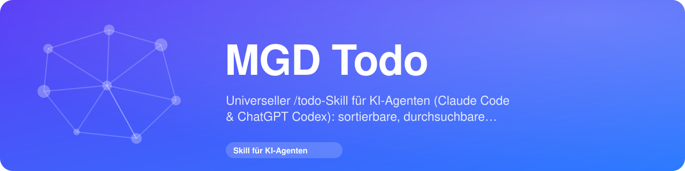

<!-- MGD-HEADER -->
<p align="center"><a href="https://Michael-Gahn.de"></a></p>

<p align="center"></p>

<p align="center">
  
  <a href="https://github.com/MichaelGahnDESIGN/MGD_Todo_SKILL/releases/latest"></a>
  
  <a href="https://Michael-Gahn.de"></a>
</p>
<!-- /MGD-HEADER -->

# 🗂️ MGD ToDo SKILL

**Eine Aufgabenliste, die sich selbst pflegt. Dazu ein Message-Board für alle deine KI-Threads, Wissenspflege und Updates auf Knopfdruck.**
Für Claude Code und ChatGPT Codex. Ohne Datenbank, ohne Server, ohne Internet-Dienste.

<p align="center">
  <b>/todo</b> · <b>/board</b> · <b>/wissen</b> · <b>/fragenkatalog</b> · <b>/prozesse</b> · <b>/skill-update</b> · <b>/MGD-update</b>
</p>

> [!TIP]
> **Neu in 1.6.0:** `/board` (Message-Board und Dashboard), `/fragenkatalog`, `/prozesse` und neun Update-Befehle. Alles in einem Skill.

---

## ✨ Was kann der Skill?

| | Befehl | Was passiert |
|---|---|---|
| ✅ | `/todo` | Alle Aufgaben in **einer** HTML-Datei: sortierbar, durchsuchbar, mit Kategorien. Nichts wird gelöscht, nur auf „erledigt" gesetzt. |
| 📊 | `/board` | **Message-Board und Dashboard.** Mehrere KI-Threads schreiben in ein gemeinsames Protokoll. Du siehst alles auf einer Seite mit Ampeln. |
| 🧠 | `/wissen` | Zieht TODO, Wissensgraph und Living Documentation nach einem Arbeitsblock nach. |
| 👀 | `/wissen-ansehen` | Öffnet die vorhandene Projektdokumentation, ohne etwas zu ändern. |
| ❓ | `/fragenkatalog` | Durchsuchbarer Fragenkatalog mit KI-Antworten aus Experten-Sicht und Feld für deine eigene Antwort. |
| 🔧 | `/prozesse` | Prüft Hintergrundprozesse: Was läuft wirklich, was ist eine Karteileiche? |

### 🔄 Die Update-Befehle

| Befehl | Was passiert |
|---|---|
| `/dashboard-update` | Dashboard neu erzeugen und öffnen |
| `/messageboard-update` | Neue Chat-Meldungen lesen, Status nachziehen, Dashboard erneuern |
| `/wissen-update` | `/wissen` und danach Dashboard |
| `/todo-update` | TODO-Datei aktualisieren (Erledigtes schließen, Neues eintragen) |
| `/living-doku-update` | Living Documentation aktualisieren |
| `/skill-update` | **Alle lokalen MGD-Skills** mit der neuesten GitHub-Version vergleichen und aktualisieren (mit Sicherung) |
| `/repo-update` (= `/github-update`) | README, Wiki, Skill-Empfehlungen, neue Release-Version und bei Bedarf ZIP-Paket |
| `/repo-check` | Repo prüfen: README, Lizenz, Impressum, Links |
| `/related-update` | „Skill-Empfehlungen" in allen MGD-Repos gleich halten |
| `/MGD-update` | **Alles in beide Richtungen:** GitHub → lokal und lokal → GitHub |

---

## 🚀 In 3 Schritten starten

1. **Skill installieren** (Claude Code):
   ```bash
   git clone https://github.com/MichaelGahnDESIGN/MGD_Todo_SKILL.git ~/.claude/skills/todo
   ```
   Für Codex: in `~/.codex/skills/todo` ablegen.
2. **Befehl eingeben:** `/todo` und sagen, wo die Datei liegen soll, z. B. `TODO/TODO.html`.
3. **Aufgabe hinzufügen:** `/todo add "Erste Aufgabe"`. Fertig.

Für das Message-Board: `/board` eingeben. Die genaue Anleitung steht in [docs/board.md](docs/board.md).

---

## 📊 Das Message-Board in einem Satz

Arbeiten viele KI-Threads gleichzeitig, schreiben sie in **ein gemeinsames Protokoll**. Das Dashboard macht daraus eine Seite mit **Fortschrittsbalken, Thread-Ampeln, offenen Fragen an dich und den letzten Nachrichten**. Nur lesend, offline, ohne Fremdbibliothek. Mit `/board live` erneuert es sich alle 5 Minuten, ohne Tokens.

---

## 📚 Dokumentation

- [Einsteiger-Anleitung zu /todo](docs/anleitung.md): alles Schritt für Schritt
- [Board und Dashboard](docs/board.md)
- [Wissenspflege mit /wissen](docs/wissen.md)
- [Projektdokumentation und Links](docs/project-documentation.md)
- [Fragenkatalog](docs/fragenkatalog/Home.md)
- [Wiki auf GitHub](https://github.com/MichaelGahnDESIGN/MGD_Todo_SKILL/wiki)
- [Änderungen (CHANGELOG)](CHANGELOG.md)

## 🛡️ Sicherheit

- Keine Passwörter, Tokens oder personenbezogenen Daten in Aufgaben oder im Chat-Protokoll.
- Aufgaben werden **nie gelöscht**, nur als erledigt markiert.
- Keine externen Dienste, kein CDN, kein Tracking. Alles funktioniert offline.
- Update-Befehle sichern vor dem Überschreiben und fragen bei lokalen Anpassungen.

<!-- MGD-RELATED:START -->
## Skill-Empfehlungen

Passt gut dazu:

| Skill | Befehl | Wofür |
|---|---|---|
| [MGD_Living-Documentation](https://github.com/MichaelGahnDESIGN/MGD_Living-Documentation) | `/doku` | Lebendige Dokumentation: keine Entscheidung geht verloren |
| [MGD_DEV_SKILL](https://github.com/MichaelGahnDESIGN/MGD_DEV_SKILL) | `/dev` | Release, Sync, Backup, Cleanup, Tests und Wissensdokumentation |
| [MGD_AI-Thread](https://github.com/MichaelGahnDESIGN/MGD_AI-Thread) | `/thread` | Ehrliche Übergabe, bevor das Kontextfenster voll ist |
| [MGD_Autopilot_SKILL](https://github.com/MichaelGahnDESIGN/MGD_Autopilot_SKILL) | `/autopilot` | Projektziele sicher unbeaufsichtigt abarbeiten |
| [MGD_ProjectClean_SKILL](https://github.com/MichaelGahnDESIGN/MGD_ProjectClean_SKILL) | `/projectclean` | Abschluss und Aufräumen: Version, Tests, Commit, Doku, Backup |

## Verwandte MGD Projekte

<details><summary>Alle MGD-Skills und Werkzeuge anzeigen</summary>

| Projekt | Befehl | Wofür |
|---|---|---|
| [MGD_DEV_SKILL](https://github.com/MichaelGahnDESIGN/MGD_DEV_SKILL) | `/dev` | Release, Sync, Backup, Cleanup, Tests und Wissensdokumentation |
| [MGD_Autopilot_SKILL](https://github.com/MichaelGahnDESIGN/MGD_Autopilot_SKILL) | `/autopilot` | Projektziele sicher unbeaufsichtigt abarbeiten |
| [MGD_Backup_SKILL](https://github.com/MichaelGahnDESIGN/MGD_Backup_SKILL) | `/backup` | Backups lokal, NAS und Cloud mit Prüfsummen |
| [MGD_AI-Thread](https://github.com/MichaelGahnDESIGN/MGD_AI-Thread) | `/thread` | Ehrliche Übergabe, bevor das Kontextfenster voll ist |
| [MGD_ProjectClean_SKILL](https://github.com/MichaelGahnDESIGN/MGD_ProjectClean_SKILL) | `/projectclean` | Abschluss und Aufräumen: Version, Tests, Commit, Doku, Backup |
| [MGD_Living-Documentation](https://github.com/MichaelGahnDESIGN/MGD_Living-Documentation) | `/doku` | Lebendige Dokumentation: keine Entscheidung geht verloren |
| [MGD_BugReport_SKILL](https://github.com/MichaelGahnDESIGN/MGD_BugReport_SKILL) | `/bugreport` | Handbuch für Bug-Reports, Feedback und QA in Apps |
| [MGD_AI-PlayTest_SKILL](https://github.com/MichaelGahnDESIGN/MGD_AI-PlayTest_SKILL) | `/playtest` | Test aus Nutzerperspektive für KI-gebaute Funktionen |
| [MGD_AI-Testaccount_SKILL](https://github.com/MichaelGahnDESIGN/MGD_AI-Testaccount_SKILL) | `/testaccount` | Testkonten per Plus-Adresse mit klaren Sicherheitsregeln |
| [MGD_Software-Updater_SKILL](https://github.com/MichaelGahnDESIGN/MGD_Software-Updater_SKILL) | `/software-updater` | Update-Systeme planen und umsetzen |
| [MGD_Divi5-Dev_SKILL](https://github.com/MichaelGahnDESIGN/MGD_Divi5-Dev_SKILL) | `/divi` | WordPress und Divi 5: Animationen, Plugins, Child-Themes |
| [MGD_JTL-OPC_SKILL](https://github.com/MichaelGahnDESIGN/MGD_JTL-OPC_SKILL) | `/jtl-opc` | JTL-Shop-5-Seiten im OnPage Composer automatisch befüllen |
| [MGD-SEO](https://github.com/MichaelGahnDESIGN/MGD-SEO) | `/seo` | SEO-Skill mit lokalem Prüfkern |
| [MGD-Motion-Graphics-Video-Skill](https://github.com/MichaelGahnDESIGN/MGD-Motion-Graphics-Video-Skill) | `/mgd-video` | Reels, YouTube, Werbefilme und Animationen |
| [MGD-Foundry-VTT_Skill](https://github.com/MichaelGahnDESIGN/MGD-Foundry-VTT_Skill) | `/vttl-notizbuch` | Foundry VTT und D&D-Notizbücher |
| [MGD_AI-Basic-Projektordner_TOOL](https://github.com/MichaelGahnDESIGN/MGD_AI-Basic-Projektordner_TOOL) | `Vorlage` | Projektordner für ChatGPT Codex, Cowork und Claude Code |
| [MGD_Docker_Projektbuilder](https://github.com/MichaelGahnDESIGN/MGD_Docker_Projektbuilder) | `Generator` | Docker-Plattform-Gerüste aus sechs Fragen |
| [MGD_Claude-Codex_MCP](https://github.com/MichaelGahnDESIGN/MGD_Claude-Codex_MCP) | `MCP` | Lokales MCP für Aufgaben, Chat und Übergaben zwischen KI-Agenten |

</details>

Mit `/skill-update` (im Todo-Skill) holst du alle lokal installierten MGD-Skills auf den neuesten Stand.
<!-- MGD-RELATED:END -->

<!-- MGD-LEGAL -->
---

## Lizenz

Dieses Projekt steht unter der [MIT-Lizenz](https://opensource.org/license/mit). Den vollständigen Text enthält die Datei [LICENSE](LICENSE).

## Impressum

**Angaben gemäß § 5 DDG (Digitale-Dienste-Gesetz)**

Michael Gahn DESIGN  
Michael Gahn  
Dr.-Theodor-Brugsch Str. 12  
08529 Plauen  
Sachsen  
Deutschland

Tel.: +49 (0) 151 59156639  
E-Mail: Anfrage@Michael-Gahn.de

Umsatzsteuer-Identifikationsnummer gemäß § 27 a Umsatzsteuergesetz:  
Steuernummer: 223/222/02451  
Ust-ID: DE288143343

Wir sind zur Teilnahme an einem Streitbeilegungsverfahren vor einer Verbraucherschlichtungsstelle weder verpflichtet noch bereit.

**Redaktionell verantwortlich:**

Michael Gahn DESIGN  
Michael Gahn  
Dr.-Theodor-Brugsch Str. 12  
08529 Plauen  
Sachsen  
Deutschland

Tel.: +49 (0) 151 59156639  
E-Mail: Anfrage@Michael-Gahn.de
<!-- /MGD-LEGAL -->
